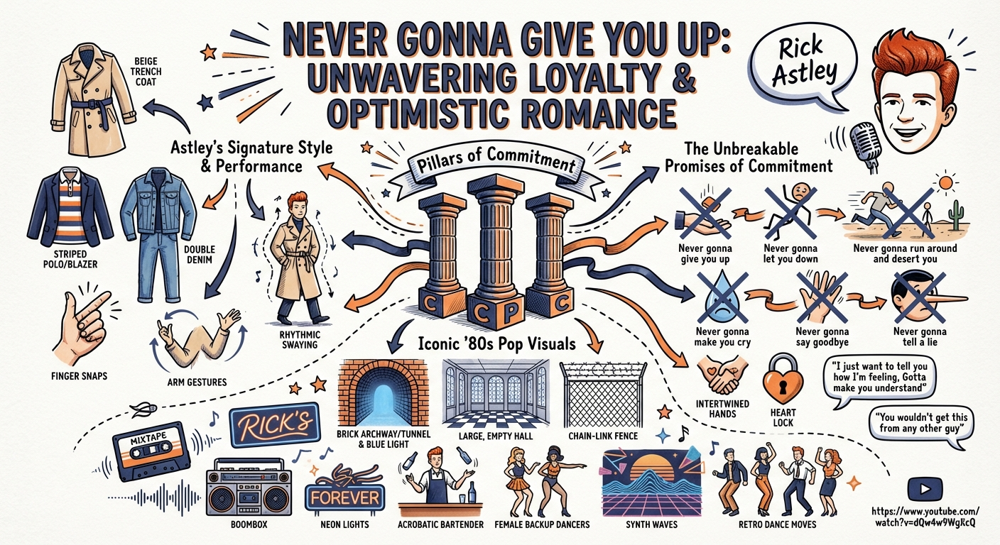

# Drawing insights: building a sketchnote artist with Gemini 3 and Go

Have you ever watched a technical talk and found yourself nodding along, only to realise an hour later that the key concepts have evaporated from your mind? That used to be me, until I discovered sketchnoting.

Years ago, I stumbled upon **sketchnoting**, the practice of creating visual summaries of content, and it transformed how I learn. As a visual learner, I remember not just *what* I read but *where* it sits on the page. By translating abstract concepts into spatial, visual notes, my retention improved dramatically. It was never about creating attractive pictures; it was about mapping information in a way my brain could navigate and recall.

But here is the problem: I cannot be everywhere at once, and I cannot sketch every video I watch.

So I asked myself: **What if I could build an AI agent that watches videos for me and generates the sketchnotes I wish I had time to draw?**

## Enter the Sketchnote Artist

I am pleased to share **Sketchnote Artist**, an open-source project I built to automate this visual learning loop. Give it a YouTube video URL, and it transforms the content into a beautifully illustrated, hand-drawn-style sketchnote that captures the essence of what matters most.

### Under the hood: the sequential agent workflow

This is not a wrapper around an API call. It demonstrates the **Sequential Agent** pattern using the **Google Agent Development Kit (ADK) for Go**.

I chose Go because its strong typing make it ideal for building robust, production-ready agents but mainly because it has fast cold-start times on Cloud Run. The architecture orchestrates two specialised agents working in sequence:

1. **The Summariser (Curator)**:
    * **Role**: content strategist
    * **Brain**: **Gemini 3 Flash**. I chose Flash for its massive context window and speed. It can ingest entire video transcripts in one go and synthesise them into a structured 'Visual Brief', distilling the core thesis, key takeaways and compelling quotes.
2. **The Artist**:
    * **Role**: master illustrator
    * **Tools**: **Gemini 3 Pro Image**. This agent interprets the visual brief and orchestrates the image generation. The quality leap with Imagen 3 is impressive: it handles text rendering and stylistic nuances, such as simulating the texture of alcohol markers on paper, with remarkable fidelity.

### Flexible workflow: CLI or web

One of the strengths of the Go ADK is its versatility. I designed Sketchnote Artist to work however you prefer:

1. **Local CLI**: Perfect for developers who live in the terminal. Run it locally, pipe in a YouTube URL, and watch the agents work in real time.
2. **Hosted web UI**: Prefer a friendlier interface? The project includes a server mode that deploys to Google Cloud Run, giving you a clean web UI where anyone can submit videos and view generated sketchnotes from any browser.

### Seeing it in action

The interaction is deliberately simple, regardless of how you run it. You provide a URL, and the system handles the complex orchestration behind the scenes.

**CLI example:**

```bash
$ go run ./cmd/sketchnote console

User -> https://www.youtube.com/watch?v=dQw4w9WgXcQ
```

Behind the scenes, the Summariser processes the video, extracts the essential insights and hands off a baton, the Visual Brief, to the Artist. The Artist then 'draws' the final output, turning abstract concepts into concrete visuals.

**The result:**

Instead of a wall of text or fragmented notes, you get a clean, visual artefact like this:



*(Check out the `assets/` folder in the repo for the full-resolution version.)*

## Why this matters

As a Google Developer Expert, I have seen countless AI demos. But building this one felt different. It was a convergence of capabilities that made something I have wanted for years practical:

* **Gemini 3 Flash** makes the 'reasoning' phase fast enough to feel seamless
* **Gemini 3 Pro Image (Nano Banana Pro)** makes the 'creation' phase high-quality enough to be useful
* **Go ADK** makes the plumbing robust enough to be maintainable and production-ready

This is not about impressive technology alone. It solves a problem in how I consume and retain knowledge.

## Try it yourself

This project has been a pleasure to build, not because the tech stack is exciting, but because it improves my learning workflow.

I would be delighted if you gave it a spin. Whether you want to generate sketchnotes for your own learning or dive into the code to see how a multi-agent system is structured in Go, the repository is ready for you.

Clone it, run it locally, and let AI sketch your next learning session.

[https://github.com/danielvaughan/sketchnote-artist](https://github.com/danielvaughan/sketchnote-artist)

### Live demo

I also have a version deployed at [https://sketchnotes.danielvaughan.com](https://sketchnotes.danielvaughan.com).

Please note that **access is restricted** to manage costs. If you would like to try the live version, please email your Google email address to **<sketchnotes@danielvaughan.com>**, and I will be happy to onboard you.

Happy coding (and sketching)!
